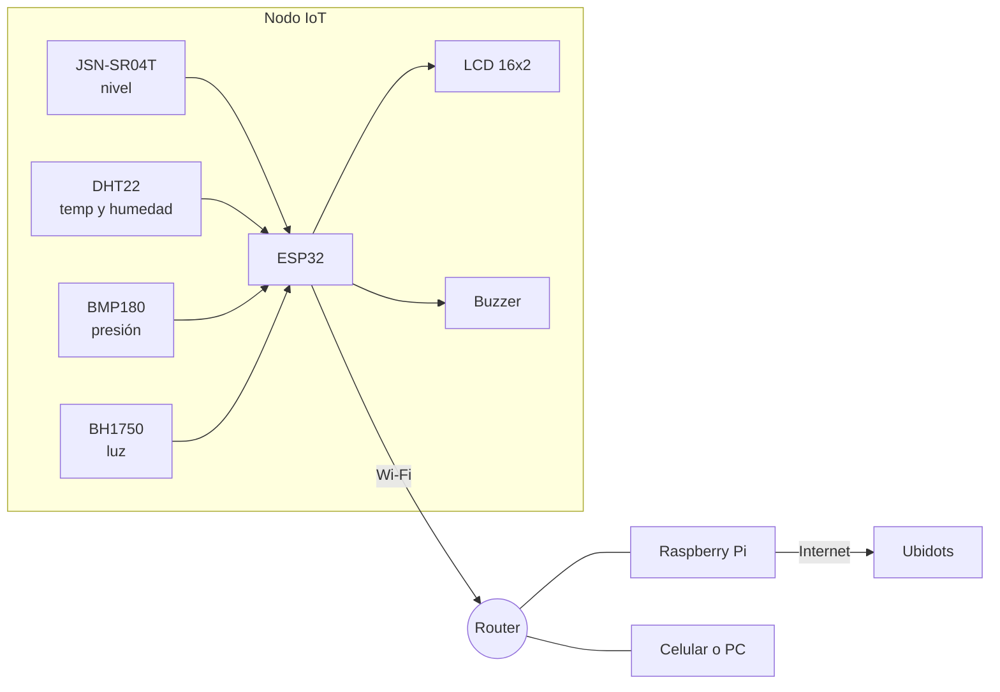
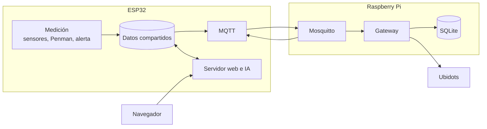
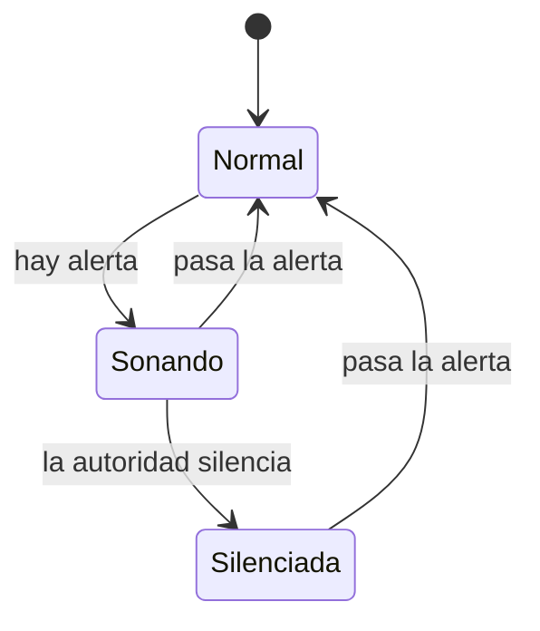

# Diseño

## Restricciones

Usamos un ESP32 porque tiene Wi-Fi y dos núcleos. El Arduino Uno del Challenge #1 no tenía Wi-Fi.

El enunciado pide que la medición y la transmisión corran fuera del hilo principal. Por eso hay tres hilos de FreeRTOS. La medición va en el núcleo 0. MQTT y el loop principal con el servidor web y la IA van en el núcleo 1. Un mutex protege los datos que comparten.

La Raspberry Pi hace de gateway. Corre el broker Mosquitto y un programa en Python que guarda los datos en SQLite y los manda a Ubidots. Todo viaja por MQTT.

Los dos tableros piden usuario y contraseña. El local además puede limitar el acceso a ciertas IP. Desde el tablero local las autoridades pueden silenciar la alarma, y el ESP32 también acepta esa orden por MQTT.

El nodo cuesta cerca de 195 000 COP sin la Raspberry Pi. La caja va fija sobre el agua porque si flotara el ultrasónico mediría siempre lo mismo. El sensor queda a más de 25 cm del agua por su zona ciega. Cada nodo publica con su propio identificador, así un gateway puede atender varios.

Por tiempo priorizamos la integración completa sobre una prueba en campo.

Los umbrales se fijaron para un embalse de la sabana a unos 2 600 m. Ahí la presión normal ronda 745 hPa, así que la presión anómala quedó en 735 hPa.

## Arquitectura

### Hardware

### Software

El ESP32 publica las mediciones en el tópico happymoist/01/datos. Al conectarse avisa que está en línea en happymoist/01/estado. Si se cae, el broker publica solo que está desconectado. Para silenciar la alarma se le escribe en happymoist/01/cmd.

Si un sensor falla su dato no se envía. Así un sensor caído no se confunde con un cero.

El gateway guarda cada dato en SQLite. Cada 5 minutos promedia lo pendiente y lo publica en Ubidots. Para la alerta manda el máximo, así una alerta corta no se pierde. Si se cae internet los datos esperan en la base y salen cuando vuelve.

## Hardware

| Componente | Conexión |
|---|---|
| JSN-SR04T | 5V, TRIG a GPIO17, ECHO a GPIO18 con divisor de 1 kΩ y 2 kΩ |
| DHT22 | 3.3V, datos a GPIO4 |
| BMP180 y BH1750 | 3.3V, SDA a GPIO21, SCL a GPIO22 |
| LCD 16×2 | RS 19, E 23, D4 32, D5 33, D6 26, D7 27 |
| Buzzer | GPIO25 |

El divisor baja los 5 V del ultrasónico a 3.3 V para no dañar el ESP32. Evitamos los pines que afectan el arranque y los que solo son de entrada.

Los precios aproximados son 30 000 el ESP32, 35 000 el ultrasónico, 18 000 el DHT22, 10 000 el BMP180 y 12 000 el BH1750. La pantalla, el buzzer, las resistencias, el protoboard, la power bank y la caja suman unos 90 000. En total son cerca de 195 000 COP.

## Módulos

### Evaporación

Usamos Penman (1948) en su forma para agua libre. La ecuación combina la radiación, que sale del BH1750, con el aire seco, que sale del DHT22. La presión del BMP180 entra en las constantes del aire. Como no tenemos anemómetro asumimos un viento de 2 m/s, que es el valor que recomienda la FAO-56.

El resultado está en mm/día. Supone que las condiciones del momento se mantienen todo el día.

### Alerta

La alerta se activa cuando el nivel baja de 40 cm y además pasa una de estas tres cosas: la evaporación supera 4 mm/día, la humedad baja de 20 % o la presión baja de 735 hPa.

Una lectura inválida queda como sin dato y nunca dispara la alerta. En el Challenge #1 una presión inválida sí generó una falsa alarma y por eso lo cambiamos.

Silenciar solo apaga el buzzer. La pantalla y el tablero siguen mostrando la alerta.

### Tablero local

El ESP32 sirve una página con los valores actuales, la gráfica del histórico, la recomendación de la IA y el botón de silenciar. La página consulta al ESP32 cada pocos segundos y siempre pide usuario y contraseña.

## Estándares

Usamos MQTT 3.1.1 para la comunicación y Wi-Fi IEEE 802.11 en 2.4 GHz. El tablero local usa HTTP con autenticación básica y los mensajes van en JSON. Los sensores de presión y luz comparten un bus I²C. La evaporación sigue a Penman (1948) y a la FAO-56. Para la caja apuntamos al grado IP55 de la IEC 60529. El sistema no guarda datos personales, en línea con la Ley 1581 de 2012.
