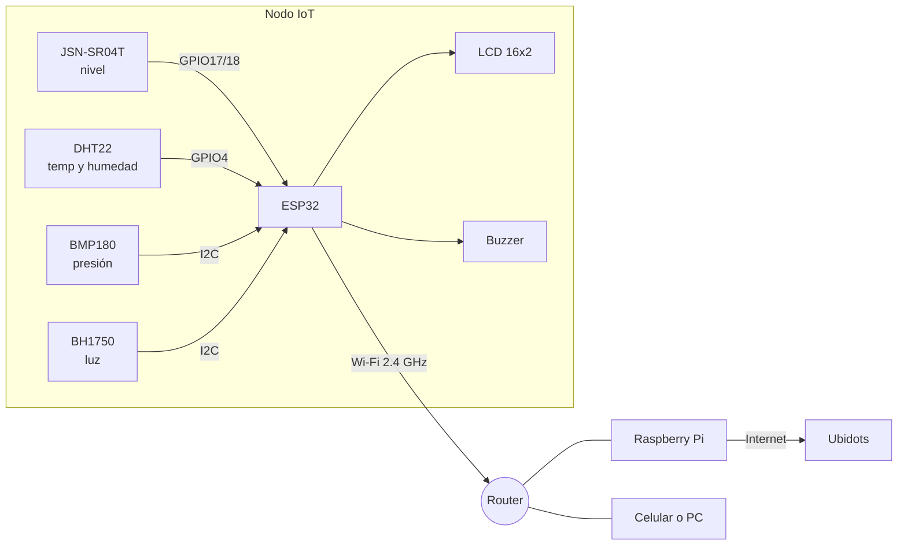
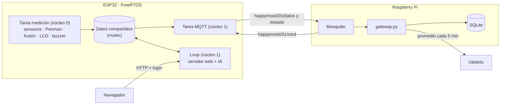
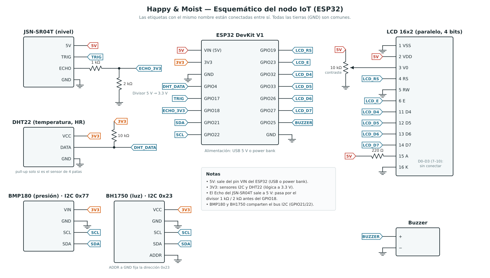
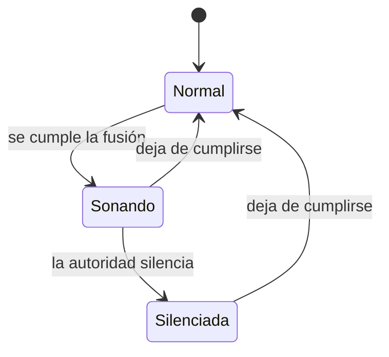

# Diseño

## Restricciones y decisiones

| Restricción | Decisión |
|---|---|
| Microcontrolador con Wi-Fi | ESP32 DevKit V1. Tiene Wi-Fi y dos núcleos. El Arduino Uno del Challenge #1 no tenía Wi-Fi |
| Raspberry Pi como gateway | Corre Mosquitto y `gateway.py`, que guarda en SQLite y envía a Ubidots |
| Medición y transmisión fuera del hilo principal | Tres hilos FreeRTOS: medición (núcleo 0), MQTT (núcleo 1) y loop con servidor web e IA (núcleo 1). Un mutex protege los datos compartidos |
| MQTT de punta a punta | PubSubClient en el ESP32 con Last Will. El gateway publica en Ubidots por MQTT |
| Alarma en el sitio | Buzzer y LCD 16×2 |
| Tableros con acceso restringido | Tablero local con usuario, contraseña y lista blanca de IPs. Ubidots con cuenta del equipo |
| Las autoridades apagan la alarma | Botón "Silenciar alarma física" en el tablero local y comando MQTT `silenciar`. Se rearma cuando termina la alerta |
| Base de datos antes de la nube | SQLite en el gateway. Un dato solo se marca enviado cuando Ubidots confirma (QoS 1) |
| Bajo costo | Cerca de 195 000 COP por nodo sin la Raspberry Pi |
| Montaje | Caja fija sobre el agua. Si flotara el ultrasónico mediría siempre lo mismo. El sensor va a más de 25 cm del agua por su zona ciega |
| Varios nodos | Cada nodo publica en `happymoist/<ID>/...` y un gateway atiende a todos |
| Tiempo | Priorizamos la integración completa sobre una prueba en campo |

Los umbrales se fijaron para un embalse de la sabana a unos 2 600 m. Ahí la presión normal ronda 745 hPa, así que la presión anómala se fijó en 735 hPa.

## Arquitectura

### Hardware



### Software



### Tópicos MQTT

| Tópico | Contenido |
|---|---|
| `happymoist/01/datos` | JSON con nivel, temp, hum, presion, radiacion, evap, alerta y la predicción de la IA |
| `happymoist/01/estado` | `online` al conectar. `offline` como Last Will si el ESP32 se cae (retenido, QoS 1) |
| `happymoist/01/cmd` | `silenciar` |

Si un sensor falla su campo no se envía. Así un sensor caído no se confunde con un cero.

### Gateway

Mosquitto escucha en el puerto 1883 sin acceso anónimo. Hay un usuario para el ESP32 y otro para el gateway.

`gateway.py` guarda cada dato en SQLite. Cada 5 minutos promedia lo que no se ha enviado y lo publica en Ubidots. Para `alerta` manda el máximo, así una alerta corta no se pierde en el promedio. Si se cae internet los datos esperan en la base. Los cambios de `online` u `offline` se envían de una vez.

## Hardware



| Componente | Conexión al ESP32 |
|---|---|
| JSN-SR04T | 5V · TRIG GPIO17 · ECHO GPIO18 con divisor 1 kΩ / 2 kΩ (5 V a 3.3 V) |
| DHT22 | 3V3 · DATA GPIO4 |
| BMP180 | 3V3 · SDA GPIO21 · SCL GPIO22 (0x77) |
| BH1750 | 3V3 · SDA GPIO21 · SCL GPIO22 (0x23) |
| LCD 16×2 | RS 19 · E 23 · D4 32 · D5 33 · D6 26 · D7 27 · RW a GND · contraste con potenciómetro |
| Buzzer | GPIO25 |

Evitamos los pines de arranque (0, 2, 12 y 15) y los que solo son de entrada (34 a 39). Ninguna señal de 5 V entra directo al ESP32.

| Componente | Precio aprox. (COP) |
|---|---|
| ESP32 | 30 000 |
| JSN-SR04T | 35 000 |
| DHT22 | 18 000 |
| BMP180 | 10 000 |
| BH1750 | 12 000 |
| LCD, buzzer, potenciómetro y resistencias | 19 500 |
| Protoboard y cables | 20 000 |
| Power bank y caja | 50 000 |
| **Total del nodo** | **≈ 194 500** |

## Módulos

### Evaporación

Usamos Penman (1948) en su forma de flujo de masa, que es la que aplica a agua libre:

E = (Δ·Rn + ρ·cp·δe·ga) / (λv·(Δ + γ))

| Término | De dónde sale |
|---|---|
| Rn, radiación neta | BH1750: lux / 126, con albedo del agua de 0.08 |
| δe, déficit de vapor | DHT22 |
| Δ y λv | Temperatura |
| γ y ρ | Presión del BMP180 |
| ga, conductancia del aire | Viento asumido de 2 m/s (FAO-56) porque no hay anemómetro |

El resultado es una tasa en mm/día. Supone que las condiciones del momento se mantienen 24 horas.

### Fusión de señales

```
alerta = nivel ≤ 40 cm  Y  (evaporación ≥ 4 mm/día  O  humedad < 20 %  O  presión < 735 hPa)
```

Una lectura inválida queda como "sin dato" y nunca dispara la alerta. En el Challenge #1 una presión inválida sí generó una falsa alarma y por eso lo cambiamos.

### Alarma física



Silenciar solo apaga el buzzer. El LCD y el tablero siguen mostrando la alerta.

### Tablero local

El ESP32 sirve una página con los valores actuales, la gráfica del histórico, la recomendación de la IA y el botón de silenciar. Todas las rutas piden usuario y contraseña.

| Ruta | Qué devuelve |
|---|---|
| `/` | La página |
| `/api/actual` | Lectura actual, alerta y predicción de la IA |
| `/api/historial` | Últimos 120 registros |
| `/api/silenciar` | Silencia el buzzer (POST) |

## Estándares

| Estándar | Uso |
|---|---|
| MQTT 3.1.1 | ESP32 a gateway y gateway a Ubidots |
| IEEE 802.11 (2.4 GHz) | Wi-Fi del ESP32 |
| HTTP/1.1 y Basic Auth (RFC 7617) | Tablero local |
| JSON (RFC 8259) | Mensajes y API |
| I²C | BMP180 y BH1750 |
| FAO-56 y Penman (1948) | Cálculo de la evaporación |
| IEC 60529 | Objetivo IP55 para la caja |
| Ley 1581 de 2012 | No se guardan datos personales y el acceso es restringido |
