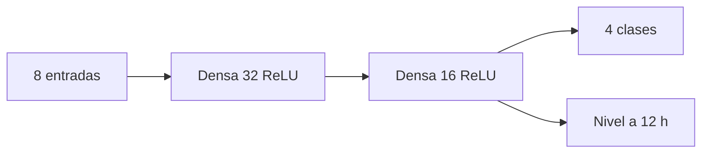

# Módulo de IA

## Qué hace

Una red neuronal pequeña corre dentro del ESP32 con TensorFlow Lite Micro. Da dos resultados:

1. El nivel esperado dentro de 12 horas.
2. Una recomendación para las autoridades.

| Clase | Recomendación |
|---|---|
| NORMAL | No hay que hacer nada. Seguir monitoreando |
| VIGILANCIA | Revisar el tablero más seguido |
| PREVENTIVA | El nivel va a cruzar el umbral. Reducir consumo y programar recarga |
| CRÍTICA | El nivel está bajo y seguirá así. Restringir el uso y activar el plan de contingencia |

La IA no decide la alarma. La alarma la decide la regla de fusión. Si la IA falla el sistema de alerta sigue igual.

## Entradas y red

Recibe 8 valores: nivel, temperatura, humedad, presión, radiación, evaporación, tendencia del nivel y tendencia de la presión. Las tendencias comparan la lectura actual con una de hace 3 horas.

Tiene 901 parámetros y pesa 6 KB. Usa 16 KB de RAM. Si falta un dato de algún sensor no responde, para no inventar.

## Entrenamiento

Usamos datos simulados. Un embalse cambia en semanas y en el semestre solo habríamos medido unos días sin sequías ni lluvias. Con un simulador generamos meses de cientos de tanques distintos, incluidos los casos raros que más importan.

El simulador modela un tanque de 200 cm hora por hora durante 60 días. Incluye lluvias con caída de presión previa, días secos, nubes, consumo y recargas. La evaporación usa la misma función de Penman del firmware. También agrega ruido de sensor.

| Parámetro | Valor |
|---|---|
| Datos | 400 tanques × 60 días = 570 000 muestras |
| División | 80 % entrenamiento y 20 % validación, separando por tanque |
| Optimizador | Adam con early stopping |
| Script | [`entrenar_modelo.py`](https://github.com/Nickjjlkm/IOT-challenge-3/blob/main/codigo/entrenar_modelo.py) |

## Resultados en validación

| Métrica | Valor |
|---|---|
| Exactitud | 89.5 % |
| Casos CRÍTICOS detectados | 98.8 % |
| Casos PREVENTIVOS detectados | 88.8 % |
| Precisión de PREVENTIVA | 47.6 % |
| Error medio del nivel a 12 h | 10.4 cm (suponer que no cambia da 11.3 cm) |

Ningún caso PREVENTIVO o CRÍTICO se confundió con NORMAL. La mitad de los avisos preventivos eran en realidad de vigilancia. Para una alerta preferimos avisar de más. La predicción del nivel casi no mejora la referencia porque el consumo del simulador es aleatorio. Lo útil del modelo es la recomendación.

## Por qué TinyML y no una API como ChatGPT

Funciona sin internet, no cuesta por consulta y responde en milisegundos. Siempre da el mismo resultado con la misma entrada y los datos no salen de la red local. En zonas rurales con mala conexión eso pesa más.

## Limitaciones

- Las métricas miden qué tan bien aprende el simulador. Falta validar con un embalse real.
- Está entrenado para 200 cm de altura. Con otro recipiente hay que reentrenarlo.
- En la demo (`IA_PRUEBA = true`) la tendencia se calcula sobre 60 s y las predicciones no son confiables.
