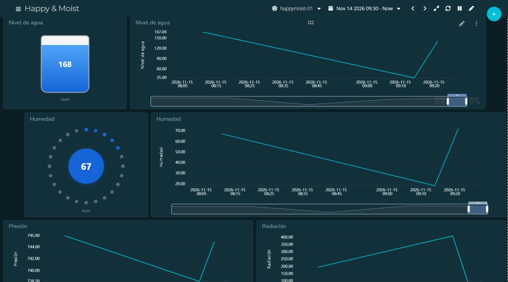

# Pruebas y resultados

## Banco de pruebas

Montamos el nodo en interiores sobre un recipiente con agua. Una lámpara sube la luz y la temperatura. Para no esperar días vaciamos y llenamos el recipiente a mano. El firmware estaba con sensores reales y la IA en modo demo.

Video: https://www.youtube.com/watch?v=zvBTsywOzQM

## Tablero local

La captura muestra un nivel de 53 cm, sobre el umbral de 40. La temperatura era 24.2 °C y la humedad 62 %, normales en interiores. La presión dio 753.5 hPa, cerca de los 745 esperados a esa altura. La radiación estaba en cero porque no había luz, y por eso la evaporación salió baja, 0.62 mm/día. El tablero dice sin alerta, que es lo correcto.

En la gráfica se ve el nivel bajar del umbral y subir otra vez cuando llenamos el recipiente.

La IA respondió preventiva aunque el nivel estaba subiendo. Pasa porque en modo demo la tendencia se mide en un minuto. Llenar unos centímetros en un minuto equivale a decenas de centímetros por hora y el modelo nunca vio algo así. Esto prueba que el modelo corre en el ESP32, no que pronostique bien.

## Ubidots

Probamos el sistema completo el 15 de noviembre de 2026 de 7:50 a 9:30 a. m.

El nivel fue de 35 a 168 cm mientras vaciábamos y llenábamos. La humedad estuvo entre 20 y 70 % y la temperatura entre 16 y 21 °C. La presión se mantuvo entre 738 y 746 hPa. Con la lámpara la radiación llegó a 400 W/m² y la evaporación a 6.4 mm/día. El nodo apareció en línea todo el tiempo.

Los datos llegaron cada 5 a 10 minutos. Como el gateway saca los promedios de SQLite, cada punto en Ubidots confirma que el dato pasó por la base.

## Qué confirmamos

La cadena completa funciona con sensores reales. Va de los sensores al tablero local, sigue por MQTT y SQLite y llega a Ubidots.

Cada sensor responde. El nivel sigue al recipiente y la radiación sube con la lámpara. La evaporación se comporta como dice Penman: con luz sube a entre 3 y 6 mm/día y a oscuras baja a menos de 1.

Con el nivel normal no hubo alerta aunque la evaporación estuviera alta. Una sola variable no dispara la alarma.

## Qué no alcanzamos a probar

No comparamos los sensores con instrumentos de referencia ni medimos cuánto tarda en sonar la alarma. Tampoco probamos el botón de silenciar, desconectar el router o el broker en pleno funcionamiento, la contraseña equivocada, el reenvío después de cortar internet ni cuánto dura la power bank.

## Autoevaluación

El protocolo demuestra que el sistema funciona de punta a punta y que la lógica de alerta es correcta. No alcanza para validarlo como instrumento de medición ni a la IA como pronóstico. Las pruebas fueron en interiores y sin una estación de referencia. Vaciar el recipiente a mano valida la lógica pero no la velocidad real de evaporación. La IA se probó en modo demo y se entrenó con datos simulados.

El siguiente paso sería dejarlo varias semanas en un reservorio real y comparar con el IDEAM. Con esos datos se reentrena el modelo.
