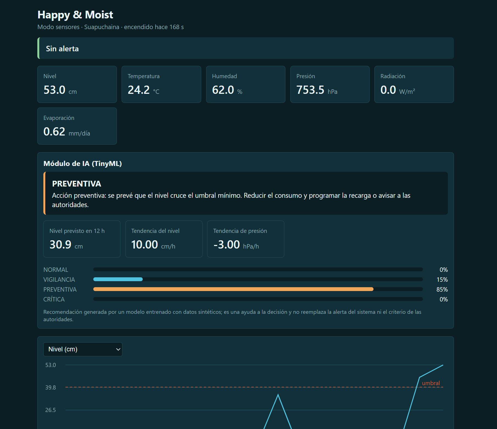
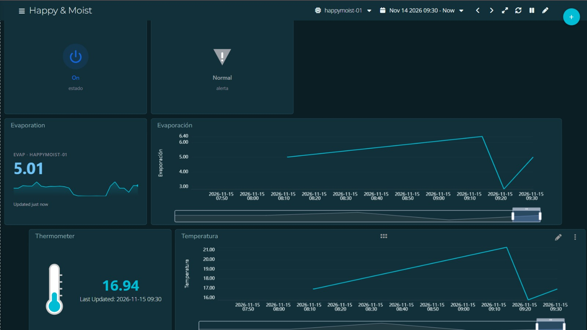

# Pruebas y resultados

## Banco de pruebas

Montamos el nodo en interiores sobre un recipiente con agua. Una lámpara sube la luz y la temperatura. Para no esperar días vaciamos y llenamos el recipiente a mano. El firmware estaba con sensores reales y la IA en modo demo.

Video: https://www.youtube.com/watch?v=zvBTsywOzQM

## Tablero local

| Variable | Valor | Comentario |
|---|---|---|
| Nivel | 53.0 cm | Sobre el umbral de 40 cm |
| Temperatura | 24.2 °C | Normal en interiores |
| Humedad | 62 % | Normal en interiores |
| Presión | 753.5 hPa | Cerca de los 745 hPa esperados a esa altura |
| Radiación | 0 W/m² | Sin luz |
| Evaporación | 0.62 mm/día | Sin luz solo queda el efecto del aire seco |
| Estado | Sin alerta | Correcto |

La gráfica muestra el nivel bajando del umbral y subiendo otra vez cuando llenamos el recipiente.

La IA respondió PREVENTIVA con el nivel subiendo. Pasa porque en modo demo la tendencia se mide en 60 s. Llenar unos centímetros en un minuto equivale a decenas de cm/h y las dos tendencias se fueron al límite. Esto prueba que el modelo corre en el ESP32, no que pronostique bien.

## Ubidots

Prueba del 15 de noviembre de 2026, de 7:50 a 9:30 a. m.

| Variable | Rango observado |
|---|---|
| Nivel | 35 a 168 cm |
| Humedad | 20 a 70 % |
| Temperatura | 16 a 21 °C |
| Presión | 738 a 746 hPa |
| Radiación | 100 a 400 W/m² con la lámpara |
| Evaporación | 3 a 6.4 mm/día |
| Estado del nodo | On |

Los datos llegaron cada 5 a 10 minutos. Como el gateway promedia a partir de SQLite, cada punto en Ubidots confirma que el dato pasó por la base. El indicador On confirma que el estado del nodo llega a la nube.

## Qué confirmamos

- La cadena completa funciona con sensores reales: sensores, tablero local, MQTT, SQLite y Ubidots.
- Cada sensor responde. El nivel sigue al recipiente y la radiación sube con la lámpara.
- La evaporación se comporta como dice Penman. Con luz sube a 3 a 6 mm/día y a oscuras baja a menos de 1.
- Con el nivel normal no hubo alerta aunque la evaporación estuviera alta. Una sola variable no dispara la alarma.

## Qué no alcanzamos a probar

- Calibración contra instrumentos de referencia.
- Tiempos de respuesta de la alarma.
- El botón de silenciar y el comando MQTT.
- Desconectar el router, el broker o un sensor en funcionamiento.
- Contraseña equivocada y lista blanca.
- Reenvío desde SQLite después de cortar internet.
- Autonomía con la power bank.

## Autoevaluación

El protocolo demuestra que el sistema funciona de punta a punta y que la lógica de alerta es correcta. No alcanza para validar el sistema como instrumento de medición ni la IA como pronóstico. Las pruebas fueron en interiores y sin estación de referencia. El vaciado manual valida la lógica pero no la velocidad real de evaporación. La IA se probó en modo demo y se entrenó con datos simulados.

El siguiente paso sería instalarlo varias semanas en un reservorio real y comparar con el IDEAM. Con esos datos se reentrena el modelo.
